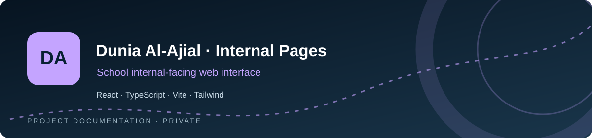
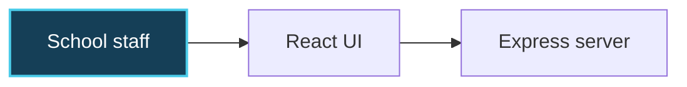

<div align="center">



# Dunia Al-Ajial · Internal Pages

**Internal-facing school experience**

  

[**Repository overview ↗**](https://github.com/a7mdel5taeeb-eng/dunia-al-ajial-all-internal-pages) · [**Architecture ↓**](#-architecture-at-a-glance) · [**Project notes ↓**](#-original-project-documentation)

</div>

---

## ✨ Overview · نبذة عن المشروع

**Private school interface**

This repository documents the school's internal pages, which are separate from the public school website. Internal routes and operational details should remain private.

| | Focus area |
|:--:|:--|
| 🧭 | Internal pages |
| 🧩 | Reusable UI |
| 🌐 | Arabic/English |
| ⚙️ | Responsive design |

**Core stack:** React · TypeScript · Vite · Tailwind

## 🧠 Architecture at a glance



*Conceptual project map — not a claim of production deployment or complete infrastructure.*

## 📂 Repository map

`src/` · `public/` · `server.ts` · `package.json` · `vite.config.ts`

## 🛡️ Working principles

- Preserve existing working functionality and keep application changes separate from documentation updates.
- Run the relevant project checks before merging application changes.
- Do not commit credentials, private customer/school data, or local environment files.
- Validate bilingual layouts, accessibility and mobile behavior where applicable.

---

## 📚 Original project documentation

The established README content below is intentionally preserved, including the project's setup instructions, detailed notes, and historical checkpoints.

---

# Dunia Al-Ajial International Schools – Internal Pages

A dedicated internal web application for **Dunia Al-Ajial International Schools – Al Kharj**.

This repository contains the school's internal pages and supporting UI components, designed to provide a consistent, modern, and responsive digital experience for school staff and internal users.

## Overview

The project is part of the school's wider digital platform and focuses on internal-facing pages rather than the public school website.

### Key Features

- Modern and responsive interface
- Internal school pages and information sections
- Consistent school branding and visual identity
- Arabic and English content support
- Reusable UI components
- Mobile-friendly layout
- Easy to maintain and extend

## Technology Stack

- React
- TypeScript
- Vite
- Tailwind CSS
- Modern component-based UI architecture

## Getting Started

### Prerequisites

Make sure you have **Node.js** installed on your computer.

### Installation

Clone the repository and install the project dependencies:

```bash
npm install
```

### Run the Development Server

Start the local development server with:

```bash
npm run dev
```

Then open the local URL provided by Vite in your browser.

## Project Purpose

The goal of this project is to build and maintain professional internal web pages for **Dunia Al-Ajial International Schools**, supporting the school's digital transformation and providing a reliable foundation for future internal features.

## Development

When adding new pages or components, please keep the existing design system, responsive behavior, bilingual support, and school branding consistent across the application.

## License

This project is intended for internal use by Dunia Al-Ajial International Schools.
